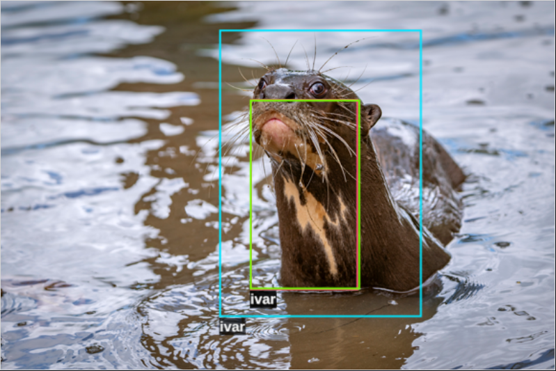
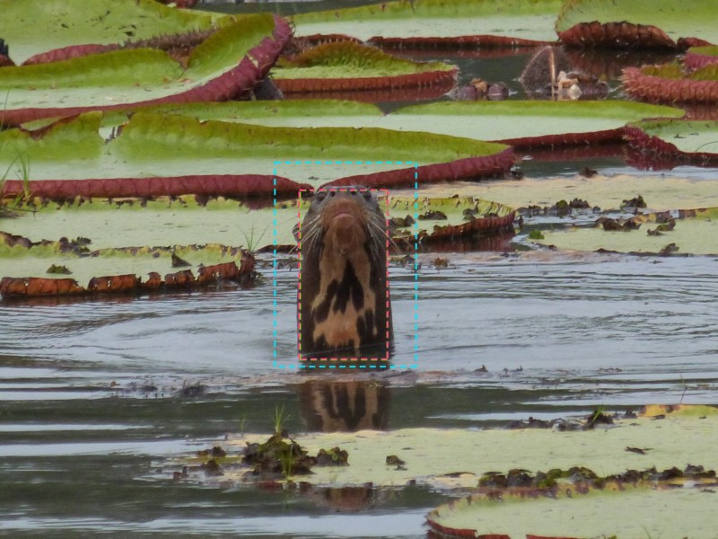
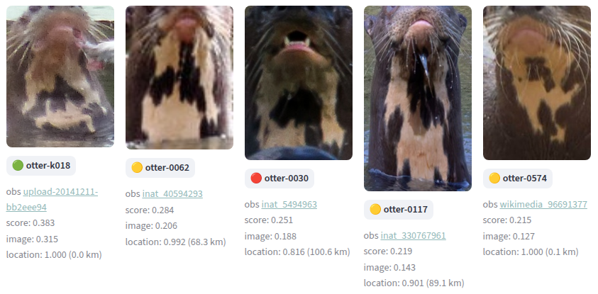

# Otter Spotter

*Project overview and status — October 2026*

Otter Spotter is a project exploring how computer vision and software tools can support giant otter monitoring. An initial machine-learning evaluation is complete, and an Android camera app prototype has been built to address the collection challenges it identified. The next step is to develop and test a field pilot with a research or conservation partner.

## Motivation and opportunity

Giant otters have individually distinctive throat markings that allow researchers to recognize animals from photographs. Linking sightings of the same individual over time can help build encounter histories and support research into group membership, movements, and persistence in an area.

Researchers, guides, lodge staff, and visitors could all contribute photographs. However, turning those observations into a useful monitoring record takes more than collecting images. The identifying markings must be visible, photographs must be shared with a central collection, and sightings need reliable dates, locations, and expert review.

Otter Spotter explores two ways software could help: 1) assist in identifying individuals from photographs in an existing identity catalog, and 2) support crowd-sourcing through a camera app that makes it easier for contributors to collect and submit useful evidence. A monitoring program is still needed to define research questions, a collection protocol, and people responsible for reviewing records.

## Identification system

The identification workflow has two main parts:

1. **Detection:** Find otters in a photograph and locate the throat region, with a useful view of the identifying pattern.
2. **Identification assistance:** Compare that portrait with photographs of cataloged individuals and return a ranked list of candidate matches. Geographic proximity provides an additional clue when location is available.

| Detect otter and throat pattern |
| :---: |
|  |
| Identify a ranked list of similar otters |
| |

A human reviewer would compare the suggested matches and supporting photographs, then confirm an identity, reject the suggestions, or leave the observation unresolved.

## What the evaluation found

In tests matching photographs across separate encounters, the correct individual was the first suggestion **88.6%** of the time and appeared among the first five suggestions **96.3%** of the time. Selecting useful throat views, adapting an existing wildlife identification model to giant otters, and adding location information all improved matching. There is evidence that performance will improve with the addition of more observation history. These results support testing the system as an aid to reviewers.

**No large, independently identified giant otter dataset was available for this evaluation.** The assembled collection combined a curated Karanambu collection with public photographs from iNaturalist, Flickr, and Wikimedia Commons. Most public images lacked individual identities, so labels had to be reconstructed by comparing throat patterns. This introduces uncertainty and possible bias. Relatively few animals had repeated encounters, limiting conclusions about performance across a larger population or a mature catalog.

The [complete evaluation analysis](https://github.com/gkyle/otter-spotter-eval/blob/main/EVALUATION.md) with metrics and source code is available in this repository.

## From evaluation to field collection

Only **1,105 of 5,418 source photographs** contained a usable throat portrait. Pose, distance, blur, lighting, and obstruction often prevented identification. Locations were frequently missing or imprecise. Transferring original photographs from a camera and submitting them later also creates an opportunity for contributions to be lost.

Those problems prompted the [**Otter Spotter Cam** Android prototype](https://github.com/gkyle/otter-spotter-cam). It:

- Runs detection on the phone, offline, automatically capturing an image when the identifying throat pattern is in frame.
- Records the available phone GPS location with photographs.
- Saves original images locally and automatically uploads when connectivity is available.

<table width="100%">
  <thead>
    <tr>
      <th width="50%" align="center">
No throat pattern visible Automatic capture waits for a useful view.
</th>
      <th width="50%" align="center">
Throat pattern detected A stable detection triggers automatic capture.
</th>
    </tr>
  </thead>
  <tbody>
    <tr>
      <td width="50%" align="center" valign="top">
        
      </td>
      <td width="50%" align="center" valign="top">
        
      </td>
    </tr>
  </tbody>
</table>

The app is in closed testing with invited participants. A complete operational review tool remains to be built, including candidate comparisons, identity decisions, catalog maintenance, and appropriate access to sensitive records. The evaluation repository contains experimental tools that can inform this work.

The main field question is whether phones can capture enough throat-pattern detail at realistic observation distances and lighting conditions. The prototype is intended to test that question and the collection workflow. It could complement contributions from dedicated cameras.

## References

- [Otter Spotter Evaluation](https://github.com/gkyle/otter-spotter-eval/blob/main/EVALUATION.md)
- [Otter Spotter Cam](https://github.com/gkyle/otter-spotter-cam)